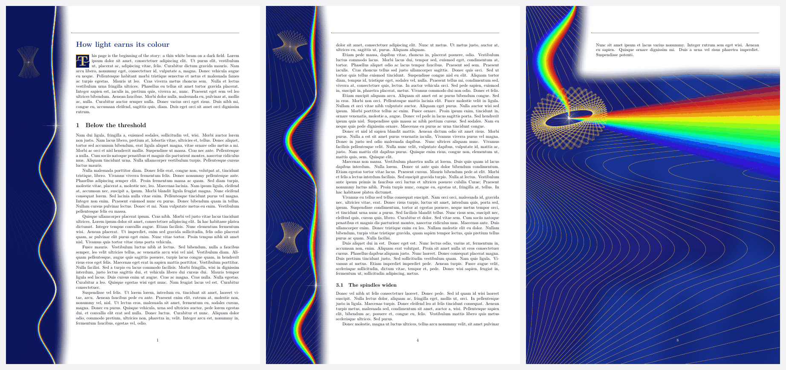
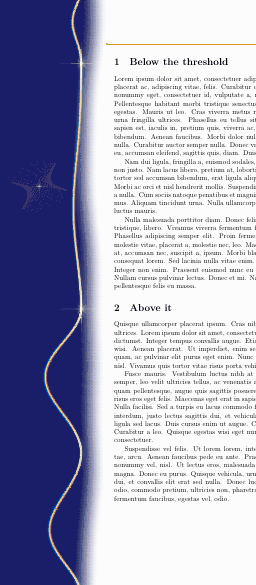
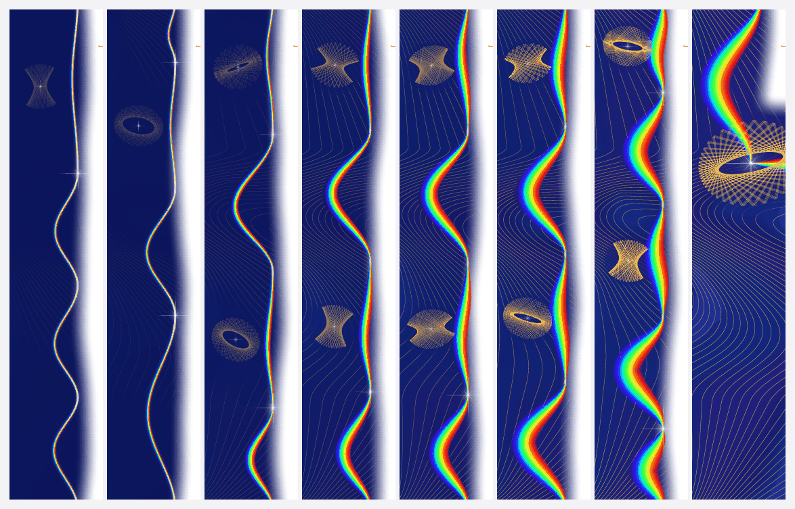
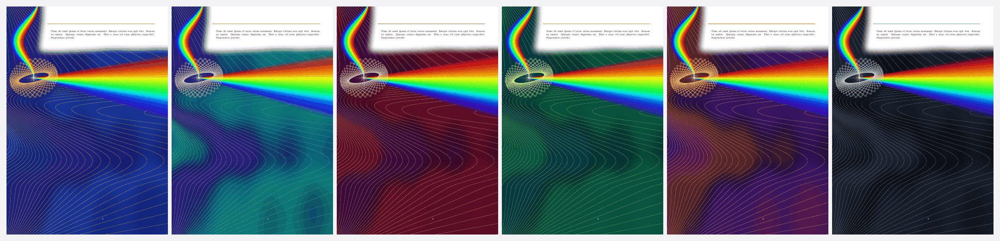
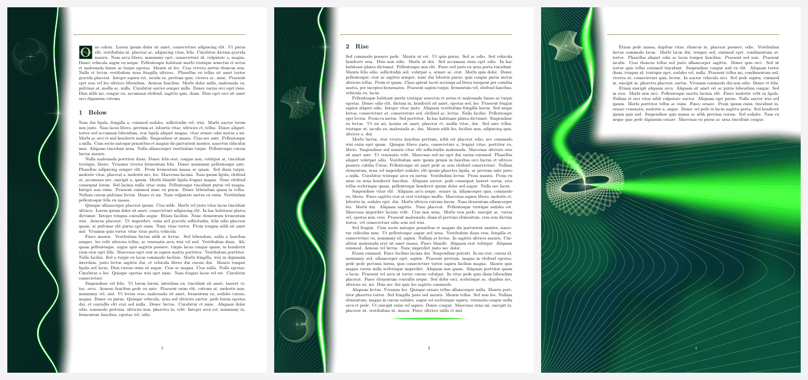
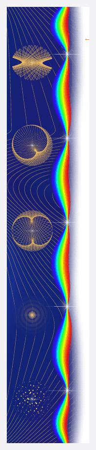
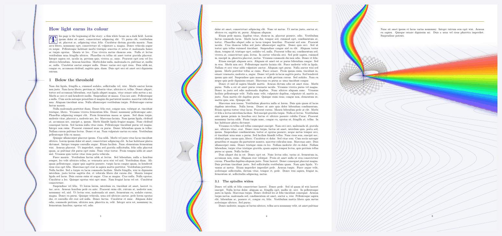
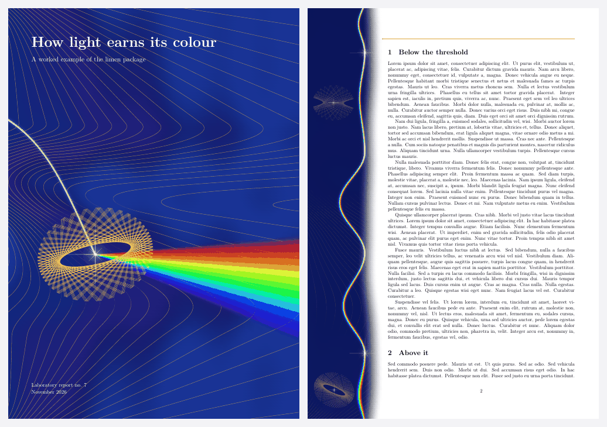
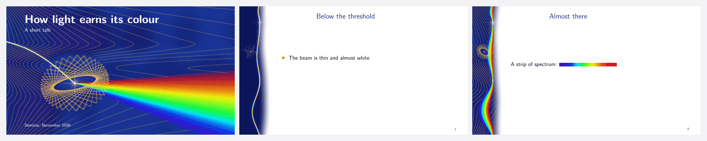
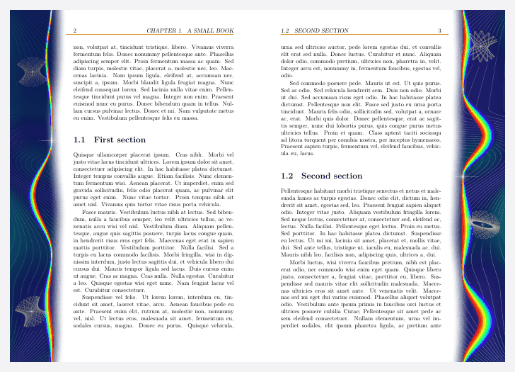

# limen

**Page margins where light has to earn its colour.** A LuaLaTeX package. [По-русски](README.ru.md)



*limen* is Latin for threshold. The margin holds a night field, fine lines of equal phase and one beam. At every heading the
beam closes into a white star; between headings it opens into a spectrum. Everything is computed in Lua while the page ships
and written straight into the PDF: no images, no external files.

The point is the story. It follows the curve of a laser's output against its pump: almost nothing below the threshold, then a
nearly straight rise. On the first pages the beam is thin and almost white, the field is dark and the lines are only beginning
to show. At the threshold the growth begins, and at the end the full spectrum leaves through the edge of the sheet.

| One page through the story | The margins of an eight-page document |
|---|---|
|  |  |

Documentation: the guide in [English](doc/limen-guide-en.pdf) and [Russian](doc/limen-guide.pdf), set in limen itself.

Try it without installing anything: open `web/index.html` in a browser to choose a palette, a threshold and a beam.

## Start

Put `limen.sty`, `limen.lua`, `limen-art.lua`, `limen-pdf.lua` and `limen-palettes.lua` next to your document, or run
`make install`. You need LuaLaTeX and LaTeX from October 2020 or later; the 2023 and 2026 releases have been tested.

```latex
\documentclass[10pt,a4paper]{article}
\usepackage[left=58mm,right=17mm,top=30mm,bottom=29mm]{geometry}
\usepackage[palette=ultramarine]{limen}
\begin{document}
\section{Below the threshold}
...
\section{The turn}
\limenthreshold % the story turns here
...
\end{document}
```

Run LuaLaTeX twice, as for a table of contents; `latexmk -lualatex` does this by itself. The art changes no text and no page
breaks, which `make test` checks.

## When to use it

| Good for | Better avoided |
|---|---|
| Writing about light, lasers, optics, spectroscopy, radiation | Journal submissions and anything with a prescribed format |
| Reports, explainers and handouts read on screen, 3 to 40 pages | Office printing in the dark mode: use `mode=paper` |
| Documents with a turn in the argument, where the threshold can stand | One or two pages: use `story=flat` |
| Talks | Wide tables on every page: the column takes about 5 cm |
| | Topics unrelated to light: the image becomes arbitrary |

## Options

`\usepackage[...]{limen}` or `\limensetup{...}` in the preamble.

| Option | Values | Effect |
|---|---|---|
| `palette` | `ultramarine`, `peacock`, `ruby`, `emerald`, `infrared`, `graphite` or your own | Colours of the field, lines and headings |
| `mode` | `night`, `paper` | Dark field for the screen, light one for a printer |
| `story` | `threshold`, `flat`, `chapter` | One rise, one fixed stage, or a rise in every chapter |
| `threshold` | 0 to 0.9, default 0.25 | Where the threshold is, without `\limenthreshold` |
| `level` | 0 to 1, default 0.75 | The stage of `story=flat` |
| `beam` | `spectrum`, `mono` | A rainbow, or one colour like a real laser |
| `wavelength` | nm | The wavelength with `beam=mono`; by default the palette's own |
| `caustic` | `ellipse`, `cardioid`, `nephroid`, `rings`, `speckle`, `mix` | Kind of caustics |
| `caustics` | 0, 1, 2 | At most this many caustics on a page |
| `density` | 0.2 to 3, default 1 | How many lines of equal phase |
| `lines`, `headings`, `finale`, `headrule` | `true`, `false` | Lines, stars at headings, closing fan, head rule |
| `column` | cm | Width of the coloured column; by default it reaches the text |
| `seed` | number | A different picture with the same story |
| `paper` | HTML colour | Paper colour if it is not white, together with `\pagecolor` |
| `initialfont` | `auto` or a file | Font of the initials; by default the document's bold face |
| `color` | `rgb`, `cmyk` | Colour model of the art, for a print shop |
| `bleed` | mm | Bleed on each side, with TrimBox and BleedBox |
| `sameart` | `true`, `false` | The same picture on every page, for animations |
| `draft` | | No art: fast builds while editing, same page breaks |

## Commands

| Command | Effect |
|---|---|
| `\limenthreshold` | The threshold is here; several of them make steps |
| `\limenstar` | A star on the beam beside this line |
| `\limencaustic[kind=rings,size=1.3]` | A caustic beside this line, radius in cm |
| `\limenrestart` | A new story, with `story=chapter` |
| `\limenlevel{0.9}` | The stage by hand from this page; `\limenlevel{}` returns to normal |
| `\limenpause` | No art on this page |
| `\limenoff`, `\limenon` | Art off and on again |
| `\limenend` | The story closes here, before appendices for example |
| `\limeninitial[3]{T}his` | A decorated initial; the word still copies and searches as a whole |
| `\limenrule[0.5\linewidth]` | A divider: a thin spindle of spectrum |
| `\limenspark[0.8em]` | A glint the size of a letter |
| `\limenspectrum[4cm]` | A strip of spectrum, 400 to 700 nm |
| `\limencover[style=dark]{title}{subtitle}{details}` | A cover on its own page |
| `\limendefinepalette{name}{deep=, flow=, flow2=, line=, caustic=, ink=, accent=}` | Your own palette |

The colours `limenink` and `limenaccent` are there for your headings and bullets.

## Palettes



## One colour, and five kinds of caustics

With `beam=mono` the beam has one colour, like a real laser, and the story shows in its width and heat.



| | |
|---|---|
|  | `ellipse`: a ray in an elliptical mirror.<br>`cardioid`, `nephroid`: the caustics of a cup.<br>`rings`: diffraction by a round aperture.<br>`speckle`: a sum of waves with random phases. |

## Paper, print shops, covers, slides, two sides

`mode=paper` is for an office printer: in the gallery's example the mean darkness of a page falls from 27 % to 7 %, by a rough
measure taken from a rendering. `color=cmyk,bleed=3` is for a print shop; the conversion is the plain formula without an ICC
profile, so ask for a proof. Before printing much, print the one-page [test sheet](doc/limen-print-test.pdf): the stages of the beam,
RGB against CMYK, the thinnest lines, smooth ramps. limen has not yet been checked on a real printer.









## Without LaTeX

The drawing is separate from TeX, so the same `limen-art.lua` runs elsewhere.

```sh
texlua limen-svg.lua --page 3 --pages 8 --palette ruby > page-3.svg   # any Lua 5.3 or later; --help for the rest
python3 typst/build.py typst/example.typ --palette ultramarine        # Typst, with typst/limen.typ
python3 web/build.py                                                  # puts web/index.html together
```

The browser page runs the package's own Lua through [Fengari](https://github.com/fengari-lua/fengari). Its paths match
`texlua` byte for byte. It shows coarser meshes than a finished PDF, because Lua runs about 20 times slower there.

## How it works

- **One form per page.** All the art of a page goes into one Form XObject with its own resources, so limen stays out of the
  page's resource dictionary. It is marked as an Artifact, so that screen readers pass over it in a tagged PDF.
- **Meshes, not stacks of contours.** Colour is painted with Gouraud meshes (PDF shading type 5), smooth at any zoom.
- **No blend modes.** Light is added up in Lua and written as opaque colours. A Screen-blended mesh turns white in Poppler,
  which blends each triangle on its own.
- **A computed spectrum.** The beam is a sum of Gaussian strands with conserved energy, so a narrow beam really adds up to
  white and a wide one really separates into pure colours.
- **Computed caustics.** Ray tracing, the geometry of envelopes and the diffraction formula.
- **A measured ending.** The closing page is measured in the finished page box, so floats and footnotes stay clear of the
  field, and the page number turns white by itself.

One convention remains, and it matters: a real Nd:YAG beam is monochromatic and invisible (1064 nm). The rainbow is an image;
the nearest physics is a supercontinuum. The scale of the lines and the bends of the beam are decorative.

## What has been checked

- **Built with** a clean TeX Live 2026 (TinyTeX, LuaHBTeX 1.24.0, LaTeX 2026-06-01) and TeX Live 2023 (Debian, LuaHBTeX 1.17.0,
  LaTeX 2023-11-01, some packages added by hand).
- **Classes:** article, report, book, scrartcl, memoir, beamer.
- **Layouts:** A4, A5, Letter, landscape, two columns, two-sided, a narrow margin, a change of margins mid-document, tinted paper.
- **Content:** Russian with babel, fancyhdr, titlesec, hyperref, TikZ, floats and footnotes on the closing page, tagging through
  `\DocumentMetadata` (2026 only).
- **Viewers:** Poppler 24.02, PDFium 158 (the engine of Chrome), pdf.js 3.2, compared automatically. Adobe Acrobat on Windows,
  looked over by hand: the cover, a page with figures and the last page.
- **Without LaTeX:** Typst 0.15.1; SVG compared with the PDF; the browser page in Chromium.

**Not checked:** Preview, Ghostscript, MuPDF, real printing, MiKTeX, Windows, macOS, PDF/A and PDF/X. Tags were
checked in the file's contents, not with the PAC or veraPDF validators. The GitHub workflows are written but have not run yet.

**Speed and size:** about half a second per page to build and about 120 KB per page. Viewers based on Poppler (Evince,
Okular) take 1 to 4 s to show a page, because Poppler cuts meshes into small pieces; PDFium and pdf.js take 0.02 to 0.3 s.
Parametric meshes were tried to help Poppler and rejected: barely faster there, files 3 to 4 times larger, pdf.js dozens of
times slower.

## What could come next

- Check Preview and a real printer. This is the largest remaining risk.
- An ICC profile and PDF/X for print shops, and crop marks.
- Running the tags through validators, and a text description of the art for screen readers.
- Initials, covers and ornaments in the Typst version.

## Development

| | |
|---|---|
| `make doc` | The guides |
| `make examples` | The examples |
| `make test` | Build every document and check text, stars, warnings, size, reproducibility |
| `make print-test` | One A4 sheet for checking a printer, `doc/limen-print-test.pdf` |
| `make gallery` | Rebuild the pictures and the animation |
| `make web` | Put the browser page together |
| `make ctan` | The archive for CTAN, through `l3build` |
| `make dist` | An archive of the project |
| `tools/crosscheck.py` | Compare PDF renderers |
| `tools/svgcheck.py` | Compare the SVG with the PDF |

## Credits

The idea of drawing margins in Lua, the page geometry and the search for marks in the page box come from
[florilegium](https://github.com/kevinraymond/florilegium) by Kevin Raymond (MIT). The art, the story and the output are new,
and florilegium is not needed. The guides are set in Lora and Inter (SIL OFL). MIT License, see [LICENSE](LICENSE).
