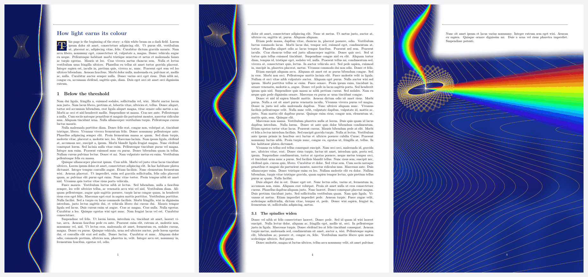
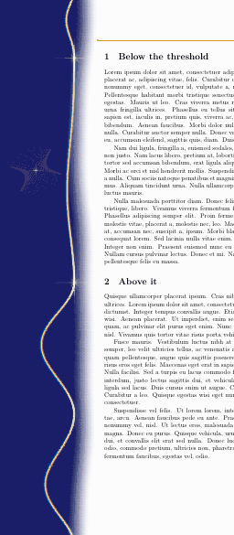
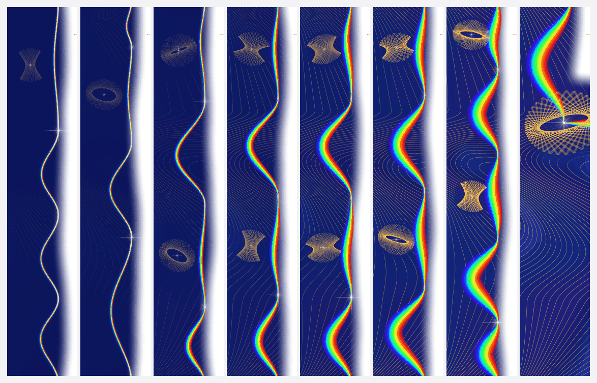
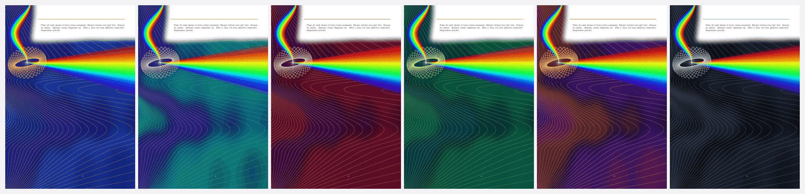
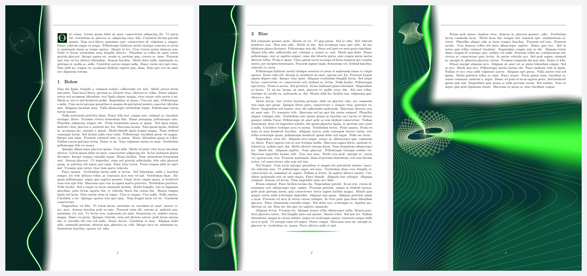
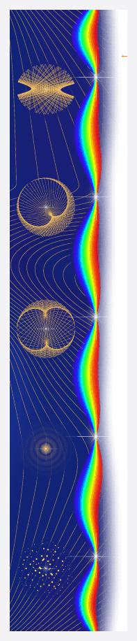
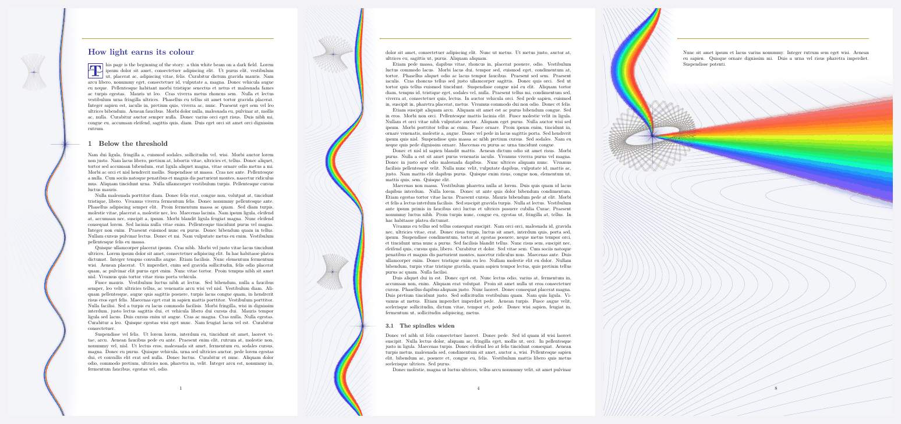
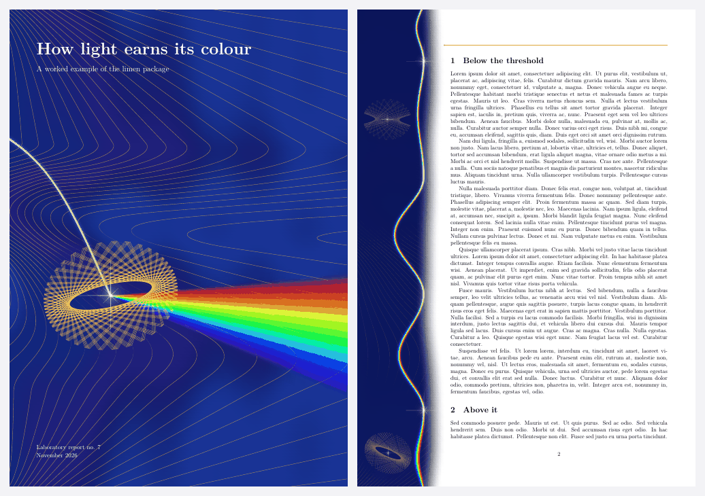
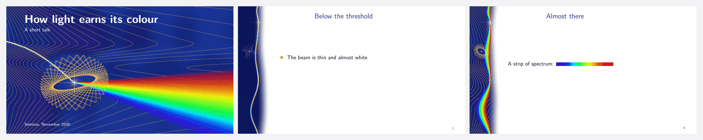
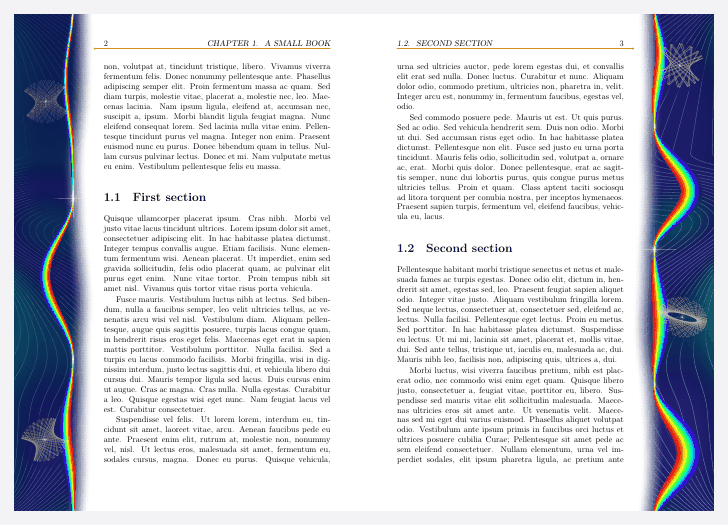

# limen

**Поля страницы, где свет заслуживает цвет.** Пакет для LuaLaTeX. [In English](README.md)



*Limen* по-латыни значит «порог». На полях лежит ночное поле, тонкие линии равной фазы и один луч. У каждого заголовка луч
сходится в белую звезду, между заголовками раскладывается в спектр. Всё считается на Lua при выводе страницы и записывается
прямо в PDF: ни картинок, ни внешних файлов.

Главное в нём сюжет. Он повторяет зависимость мощности лазера от накачки: ниже порога почти ничего, выше него почти прямая.
На первых страницах луч тонкий и почти белый, поле тёмное, линии только проступают. На пороге начинается рост, а в конце полный
спектр уходит за край листа.

| Одна страница на всём пути | Поля восьмистраничного документа |
|---|---|
|  |  |

**Подробное руководство: [`doc/limen-guide.pdf`](doc/limen-guide.pdf)**, на английском [`doc/limen-guide-en.pdf`](doc/limen-guide-en.pdf). Оба оформлены самим пакетом.

Попробовать без установки: [подберите палитру, порог и луч в браузере](https://micaelzaretsky.github.io/limen/). Та же страница лежит в `web/index.html`.

## Как начать

Положите `limen.sty`, `limen.lua`, `limen-art.lua`, `limen-pdf.lua` и `limen-palettes.lua` рядом с документом или выполните
`make install`. Нужен LuaLaTeX и LaTeX не старше октября 2020 года; проверялись выпуски 2023 и 2026 годов.

```latex
\documentclass[10pt,a4paper]{article}
\usepackage[left=58mm,right=17mm,top=30mm,bottom=29mm]{geometry}
\usepackage[palette=ultramarine]{limen}
\begin{document}
\section{Below the threshold}
...
\section{The turn}
\limenthreshold % здесь поворот сюжета
...
\end{document}
```

Собирать нужно два раза, как при оглавлении; `latexmk -lualatex` делает это сам. Текст и разбивка на страницы от рисунка не
зависят, это проверяет `make test`.

## Когда применять

| Подходит | Лучше не применять |
|---|---|
| Тексты про свет, лазеры, оптику, спектроскопию, излучение | Подача в журнал, ГОСТ и всё, где оформление задано правилами |
| Разборы, отчёты, научно-популярные тексты с экрана, от 3 до 40 страниц | Офисная печать в тёмном режиме: есть `mode=paper` |
| Документы с поворотом мысли, куда можно поставить порог | Одна-две страницы: есть `story=flat` |
| Доклады | Широкие таблицы на каждой странице: колонка занимает около 5 см |
| | Темы, не связанные со светом: образ окажется случайным |

## Опции

`\usepackage[...]{limen}` или `\limensetup{...}` в преамбуле.

| Опция | Значения | Что делает |
|---|---|---|
| `palette` | `ultramarine`, `peacock`, `ruby`, `emerald`, `infrared`, `graphite` или своя | Цвета поля, линий и заголовков |
| `mode` | `night`, `paper` | Тёмное поле для экрана или светлое для принтера |
| `story` | `threshold`, `flat`, `chapter` | Один рост, одна стадия или рост в каждой главе |
| `threshold` | от 0 до 0.9, обычно 0.25 | Где порог, если нет `\limenthreshold` |
| `level` | от 0 до 1, обычно 0.75 | Стадия при `story=flat` |
| `beam` | `spectrum`, `mono` | Радуга или один цвет, как у настоящего лазера |
| `wavelength` | нм | Длина волны при `beam=mono`; обычно своя у палитры |
| `caustic` | `ellipse`, `cardioid`, `nephroid`, `rings`, `speckle`, `mix` | Вид каустик |
| `caustics` | 0, 1, 2 | Сколько каустик на странице, не больше |
| `density` | от 0.2 до 3, обычно 1 | Сколько линий равной фазы |
| `lines`, `headings`, `finale`, `headrule` | `true`, `false` | Линии, звёзды у заголовков, финальный веер, линейка |
| `column` | см | Ширина цветной колонки; обычно она доходит до текста |
| `seed` | число | Другой рисунок при том же сюжете |
| `paper` | цвет HTML | Цвет бумаги, если он не белый, вместе с `\pagecolor` |
| `initialfont` | `auto` или файл | Шрифт буквицы; обычно полужирное начертание документа |
| `color` | `rgb`, `cmyk` | Цветовая модель рисунка, для типографии |
| `bleed` | мм | Выпуск за обрез на каждую сторону, с TrimBox и BleedBox |
| `sameart` | `true`, `false` | Один рисунок на всех страницах, для анимации |
| `draft` | | Без рисунка: быстрая сборка на время правки, разбивка та же |

## Команды

| Команда | Что делает |
|---|---|
| `\limenthreshold` | Порог в этом месте текста; несколько таких команд дают ступени |
| `\limenstar` | Звезда на луче у этой строки |
| `\limencaustic[kind=rings,size=1.3]` | Каустика у этой строки, радиус в сантиметрах |
| `\limenrestart` | Новый сюжет при `story=chapter` |
| `\limenlevel{0.9}` | Стадия вручную с этой страницы; `\limenlevel{}` возвращает обычный ход |
| `\limenpause` | На этой странице рисунка нет |
| `\limenoff`, `\limenon` | Выключить и снова включить рисунок |
| `\limenend` | Финал здесь, например перед приложениями |
| `\limeninitial[3]{T}his` | Буквица; слово копируется и ищется целиком |
| `\limenrule[0.5\linewidth]` | Разделитель: тонкое веретено спектра |
| `\limenspark[0.8em]` | Блик размером с букву |
| `\limenspectrum[4cm]` | Полоска спектра от 400 до 700 нм |
| `\limencover[style=dark]{заголовок}{подзаголовок}{подробности}` | Обложка на отдельной странице |
| `\limendefinepalette{имя}{deep=, flow=, flow2=, line=, caustic=, ink=, accent=}` | Своя палитра |

Цвета `limenink` и `limenaccent` доступны для заголовков и маркеров.

## Палитры



## Один цвет и пять видов каустик

С `beam=mono` луч одного цвета, как у настоящего лазера, а сюжет виден по его ширине и накалу.



| | |
|---|---|
|  | `ellipse`: луч в эллиптическом зеркале.<br>`cardioid`, `nephroid`: каустики чашки.<br>`rings`: дифракция на круглом отверстии.<br>`speckle`: сумма волн со случайными фазами. |

## Печать, типография, обложка, слайды, две стороны

`mode=paper` рассчитан на обычный принтер: на примере из галереи средняя темнота страницы падает с 27 % до 7 %, это грубая мера
по рендеру. `color=cmyk,bleed=3` рассчитан на типографию; цвет пересчитывается простой формулой без профиля ICC, так что нужна
цветопроба. Прежде чем печатать много, распечатайте один [лист проверки](doc/limen-print-test.pdf): стадии луча, RGB против
CMYK, самые тонкие линии, плавные переходы. На настоящем принтере limen пока не проверялся.









## Без LaTeX

Рисование отделено от TeX, поэтому тот же `limen-art.lua` работает и в других местах.

```sh
texlua limen-svg.lua --page 3 --pages 8 --palette ruby > page-3.svg   # любой Lua 5.3 или новее; остальное в --help
python3 typst/build.py typst/example.typ --palette ultramarine        # Typst, вместе с typst/limen.typ
python3 web/build.py                                                  # собирает web/index.html
```

Страница в браузере запускает собственный Lua пакета через [Fengari](https://github.com/fengari-lua/fengari). Её контуры совпадают
с `texlua` байт в байт. Сетки там реже, чем в готовом PDF, потому что Lua работает примерно в 20 раз медленнее.

## Что проверено

- **Сборка:** чистый TeX Live 2026 (TinyTeX, LuaHBTeX 1.24.0, LaTeX 2026-06-01) и TeX Live 2023 (Debian, LuaHBTeX 1.17.0,
  LaTeX 2023-11-01, часть пакетов добавлена вручную).
- **Системы:** каждая загрузка на GitHub собирается на текущем TeX Live: на Linux и macOS со всеми проверками, на Windows
  только сборка и предупреждения, потому что там нет Poppler.
- **Классы:** article, report, book, scrartcl, memoir, beamer.
- **Разметка:** А4, А5, Letter, альбомная, две колонки, двусторонняя печать, узкое поле, смена полей посреди документа, цветная бумага.
- **Содержимое:** русский язык с babel, fancyhdr, titlesec, hyperref, TikZ, плавающие рисунки и сноски на странице финала, теги
  через `\DocumentMetadata` (только 2026).
- **Просмотр:** Poppler 24.02, PDFium 158 (движок Chrome), pdf.js 3.2, сравнение автоматическое. Adobe Acrobat на Windows, вручную:
  обложка, страница с рисунками и последняя страница.
- **Без LaTeX:** Typst 0.15.1; SVG сверен с PDF; страница в браузере проверена в Chromium.

**Не проверено:** Preview, Ghostscript, MuPDF, настоящая печать, MiKTeX, PDF/A и PDF/X. Теги проверены по содержимому
файла, но не валидаторами PAC и veraPDF.

**Скорость и размер:** около половины секунды на страницу при сборке и около 120 КБ на страницу. В просмотрщиках с Poppler
(Evince, Okular) страница появляется за 1–4 с, потому что он дробит сетки на мелкие кусочки. В PDFium и pdf.js это занимает от 0,02
до 0,3 с. Параметрические сетки опробованы и отклонены: в Poppler почти нет выигрыша, файл в 3–4 раза больше, pdf.js в десятки раз
медленнее.

Настоящий луч Nd:YAG одноцветный и невидимый (1064 нм). Радуга здесь образ, ближайшая физика это суперконтинуум. Масштаб линий
и изгибы луча декоративные.

## Что можно доделать

- Проверить Preview и настоящий принтер. Это самый большой оставшийся риск.
- Профиль ICC и PDF/X для типографии, метки реза.
- Проверка тегов валидаторами и подпись рисунка для программ чтения с экрана.
- Буквица, обложка и украшения в версии для Typst.

## Разработка

| | |
|---|---|
| `make doc` | Руководства |
| `make examples` | Примеры |
| `make test` | Собрать все документы и проверить текст, звёзды, предупреждения, размер, воспроизводимость |
| `make print-test` | Один лист А4 для проверки принтера, `doc/limen-print-test.pdf` |
| `make gallery` | Заново собрать картинки и анимацию |
| `make web` | Собрать страницу для браузера |
| `make ctan` | Архив для CTAN через `l3build` |
| `make dist` | Архив проекта |
| `tools/crosscheck.py` | Сравнить просмотрщики PDF |
| `tools/svgcheck.py` | Сравнить SVG с PDF |

## Откуда это

Идея рисовать поля на Lua, геометрия страницы и поиск меток в готовой странице взяты из пакета
[florilegium](https://github.com/kevinraymond/florilegium) Кевина Рэймонда (MIT). Рисунок, сюжет и вывод написаны заново,
florilegium для работы не нужен. Руководства набраны шрифтами Lora и Inter (SIL OFL). Лицензия MIT, см. [LICENSE](LICENSE).
